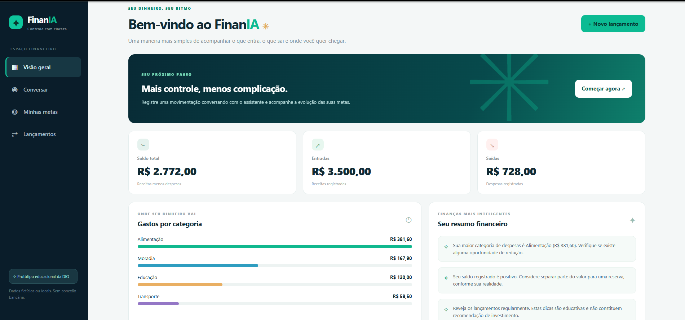

# 💸 FinanIA — App de Finanças Pessoais com Vibe Coding

**Projeto educacional para o desafio da DIO:** [App de Organização de Finanças Pessoais com Vibe Coding](https://github.com/digitalinnovationone/dio-lab-vibe-coding-app-financas).

## 🎯 Desafio e proposta
O FinanIA é o conceito de um aplicativo de controle financeiro pensado para pessoas iniciantes. Seu diferencial é permitir **registrar receitas e despesas por uma conversa simples**, organizar categorias, acompanhar metas e obter dicas educativas. O desafio original da DIO avalia principalmente a qualidade dos prompts, a definição do MVP e a reflexão sobre Vibe Coding; a demonstração codificada presente neste repositório é um **extra opcional**.

## 🌐 Demonstração publicada

- **[Abrir o FinanIA no GitHub Pages](https://black2026.github.io/dio-lab-vibe-coding-app-financas/)**
- [Repositório do projeto na conta Black2026](https://github.com/Black2026/dio-lab-vibe-coding-app-financas)

O aplicativo é um protótipo educacional. As movimentações ficam no `localStorage` do navegador, sem login ou sincronização com contas bancárias.

## ✨ O que o aplicativo faz
1. Interpreta exemplos como “Gastei R$ 45,90 no mercado” e solicita confirmação editável.
2. Sugere categorias de despesas conforme palavras-chave.
3. Permite criar metas financeiras e atualizar seu progresso.
4. Exibe dicas educativas a partir das movimentações fictícias ou locais.
5. Mostra saldo, entradas, saídas, categorias e lançamentos recentes.

> **Transparência:** a demonstração incluída neste repositório **não conecta um modelo de IA generativa**. O mecanismo de conversa usa regras JavaScript locais, sem conexão bancária ou recomendações profissionais. Agentes reais com LLM fazem parte da proposta de evolução, não de uma integração já existente.

## 🧠 PRD, prompt final e documentação do trabalho com ChatGPT

- [PRD completo e requisitos do produto](docs/PRD.md)
- [Prompt final / briefing e prompts de iteração no ChatGPT](docs/PROMPTS.md)
- [Histórico das interações de Vibe Coding realizadas no ChatGPT](docs/HISTORICO_VIBE_CODING.md)
- [Testes observados e evidências reais do protótipo](docs/EVIDENCIAS_TESTES_REAIS.md)
- [Comportamento do Agente Financeiro](docs/AGENTE_FINANCEIRO.md)
- [Fluxo de telas em Mermaid](docs/FLUXO_TELAS.md)
- [Plano do MVP e recursos](docs/PLANO_MVP.md)
- [Plano de MVP, cenários de teste e critérios de validação](docs/VALIDACAO.md)
- [Passo a passo da entrega na DIO](docs/ENTREGA_DIO.md)
- [Relatório de revisão pré-entrega, pendências e teste guiado](docs/REVISAO_PRE_ENTREGA.md)

### Prompt final — resumo
**Contexto:** aplicativo conversacional de finanças pessoais em português brasileiro. **Problema:** entrada manual excessiva e falta de feedback claro. **Público:** iniciantes. **MVP:** chat para lançamentos, classificação com revisão, metas, dicas educativas e dashboard. **Critérios:** valores em reais, confirmação antes de salvar, transparência sobre simulação de IA, privacidade e testes com dados fictícios. O texto integral para copiar está em [`docs/PROMPTS.md` — Prompt 1](docs/PROMPTS.md#prompt-1--prd-final--briefing-principal-entregável-obrigatório).

### Prompt final integral para uso na IA

```text
Você é um especialista em Product Management, UX, educação financeira e Vibe Coding.

CONTEXTO
Quero criar o FinanIA, um aplicativo de organização de finanças pessoais com interface em português do Brasil. O diferencial é registrar movimentações por conversa simples, de forma acessível e sem depender de planilhas complexas.

PROBLEMA
Pessoas iniciantes desistem de controlar o dinheiro porque os aplicativos exigem muitos campos e oferecem pouco feedback personalizado.

PÚBLICO-ALVO
Pessoas adultas iniciantes no controle financeiro, que desejam acompanhar gastos, compreender hábitos e criar metas realistas.

FUNCIONALIDADES PRINCIPAIS DO MVP
1. Registrar receitas e despesas digitando frases naturais, como “Gastei R$ 45,90 no mercado”.
2. Classificar automaticamente as movimentações e permitir revisão/correção antes de salvar.
3. Criar metas de economia e acompanhar o progresso.
4. Oferecer dicas financeiras educativas com base nas movimentações registradas.
5. Exibir dashboard com saldo, receitas, despesas e gráfico por categoria.

FLUXO ESPERADO
Ao abrir o app, o usuário vê um resumo. Pode conversar com o assistente, revisar um lançamento, confirmá-lo, acompanhar as mudanças no dashboard e criar uma meta.

REGRAS DE NEGÓCIO
Usar reais (BRL); saldo = receitas - despesas; não prometer ganhos; não realizar operações bancárias; explicar quando uma recomendação for apenas educativa; não inventar informações do usuário.

RESTRIÇÕES E PRIVACIDADE
Criar primeiro um MVP demonstrativo com dados fictícios, responsivo e acessível. Não pedir dados bancários reais, CPF, senha ou chave de API no frontend. Caso não exista backend de IA, identificar claramente o chatbot como simulação baseada em regras.

ENTREGÁVEL
Apresente: (a) resumo do produto, (b) personas e dores, (c) 5 funcionalidades prioritárias, (d) fluxo das telas, (e) comportamento do agente, (f) critérios de aceite, (g) plano inicial de validação e (h) limites do MVP. Seja objetivo e escreva em português brasileiro.
```

O arquivo [`docs/PROMPTS.md`](docs/PROMPTS.md) contém o briefing principal e prompts de iteração **preparados para reprodução**; isso não significa que todos os textos foram enviados literalmente à IA. O desenvolvimento e a revisão ocorreram com **ChatGPT**, conforme [`histórico real`](docs/HISTORICO_VIBE_CODING.md). Copilot e Lovable não foram utilizados nesta etapa.

## 🧭 Fluxo de telas
`Visão geral → Conversar → Revisar e confirmar → Lançamento salvo → Dashboard atualizado`, com acesso adicional a `Metas` e `Lançamentos`.

## 🛠️ Demonstração executável (extra)
A versão local usa HTML, CSS e JavaScript sem dependências externas. Abra `index.html` no navegador. Opcionalmente, execute um servidor local a partir da raiz:

```bash
python -m http.server 8000
```

Depois, acesse `http://localhost:8000`. Em **Lançamentos**, use **Carregar exemplo fictício**; em **Conversar**, teste “Recebi R$ 3500 de salário” ou “Gastei R$ 45,90 no mercado”. Os dados ficam apenas no `localStorage` do seu navegador.

Para executar os testes unitários, com Node.js instalado:

```bash
node --test tests/finance-engine.test.cjs
```

## 🧪 Critérios de validação
O núcleo financeiro passou por **11 testes automatizados** executados localmente. O participante também apresentou **seis capturas reais do aplicativo**, e os valores visíveis foram conferidos em [`docs/EVIDENCIAS_TESTES_REAIS.md`](docs/EVIDENCIAS_TESTES_REAIS.md). A persistência de lançamentos e metas após `F5` foi validada pelo participante na versão publicada. Os testes mobile, de acessibilidade e com outros participantes permanecem pendentes. Consulte [`docs/VALIDACAO.md`](docs/VALIDACAO.md); suas metas de sucesso ainda são **hipóteses**, não medições obtidas.

## 📸 Evidências reais do protótipo e processo com IA

Foram incorporadas **seis capturas reais do aplicativo em execução** e **uma captura da revisão do PRD com ChatGPT**, compartilhadas pelo participante em 28/10/2026. As telas do aplicativo documentam testes; a captura do ChatGPT documenta a resposta de revisão de requisitos. A primeira captura de planejamento foi dispensada por escolha do participante.

| Evidência | O que mostra | Arquivo |
|---|---|---|
| Dashboard inicial | Entradas R$ 3.500,00; saídas R$ 682,10; saldo R$ 2.817,90 | [Ver imagem](assets/evidencias/01-dashboard-inicial.png) |
| Conversa | Despesa de R$ 45,90 classificada e salva | [Ver imagem](assets/evidencias/02-chat-registro.png) |
| Dashboard atualizado | Saídas R$ 728,00; saldo R$ 2.772,00 | [Ver imagem](assets/evidencias/03-dashboard-atualizado.png) |
| Histórico | Sete movimentações e compra registrada | [Ver imagem](assets/evidencias/04-historico-lancamentos.png) |
| Meta criada | Reserva de R$ 300 / R$ 3.000 = 10% | [Ver imagem](assets/evidencias/05-meta-10-porcento.png) |
| Meta atualizada | Reserva de R$ 450 / R$ 3.000 = 15% | [Ver imagem](assets/evidencias/06-meta-15-porcento.png) |
| Revisão do PRD com ChatGPT | Critérios analisados, melhorias e conclusão da revisão | [Ver imagem](assets/evidencias/08-chatgpt-revisao-prd.png) |



**Evidência com IA incluída:** `assets/evidencias/08-chatgpt-revisao-prd.png` é uma captura real da resposta do ChatGPT à revisão do PRD. Ela não mostra o prompt do participante na mesma imagem; o contexto e as mensagens reais estão descritos em [`docs/HISTORICO_VIBE_CODING.md`](docs/HISTORICO_VIBE_CODING.md). A primeira captura foi dispensada pelo participante, sem que isso implique uso de Copilot ou Lovable. Consulte as [orientações de evidências](assets/evidencias/README.md).

## 💬 Reflexão sobre o processo de Vibe Coding — aprovada

A reflexão autoral foi **aprovada pelo participante em 28/10/2026** e está publicada integralmente em [`docs/RELATO_APRENDIZADOS.md`](docs/RELATO_APRENDIZADOS.md). Ela registra:

- **O que funcionou:** transformação de uma ideia em MVP, com dashboard, registro conversacional e metas testadas.
- **Desafios:** interpretação adequada de transações, cálculos consistentes e limitações de regras locais.
- **Aprendizados:** prompts claros, escopo, critérios objetivos e validação das sugestões da IA.
- **Próximos passos:** melhorar a interpretação, estudar integração segura com IA e ampliar recursos.

O assistente demonstrativo não utiliza IA generativa. A persistência de lançamentos e metas após `F5` foi confirmada no navegador utilizado nos testes online; cancelamento/edição e interface mobile permanecem pendentes de validação manual, sem impedir que o conceito do desafio seja documentado honestamente.

## 🔒 Segurança, limitações e privacidade
- Não utilizar CPF, senha, informações bancárias reais ou tokens em testes.
- Sem login, backend, sincronização nem integração de IA real na demonstração.
- O armazenamento local pode ser apagado pelo navegador ou ficar acessível a pessoas que usem o mesmo perfil.
- As sugestões são educativas e **não** representam orientação individual de investimento.
- Em uma versão real, seriam necessários controles adicionais de segurança e conformidade com LGPD.

## ✅ Entrega à DIO
Este projeto já está publicado em [repositório **público**](https://github.com/Black2026/dio-lab-vibe-coding-app-financas) e possui uma [demonstração online](https://black2026.github.io/dio-lab-vibe-coding-app-financas/). A captura da revisão com ChatGPT está anexada e a reflexão foi aprovada. **O envio do link na atividade da plataforma DIO continua sendo uma ação do participante.** Testes manuais ainda pendentes estão documentados como limitações. Veja o [guia completo de entrega](docs/ENTREGA_DIO.md).

## 📚 Referências
- [Repositório oficial da DIO](https://github.com/digitalinnovationone/dio-lab-vibe-coding-app-financas)
- ChatGPT — ferramenta utilizada para planejamento, construção, revisão e documentação.
- [Lovable](https://lovable.dev/) e [Microsoft Copilot](https://copilot.microsoft.com/) — ferramentas alternativas, **não utilizadas** neste processo.

**Licença de uso do material autoral deste exemplo:** MIT (ver `LICENSE`).
