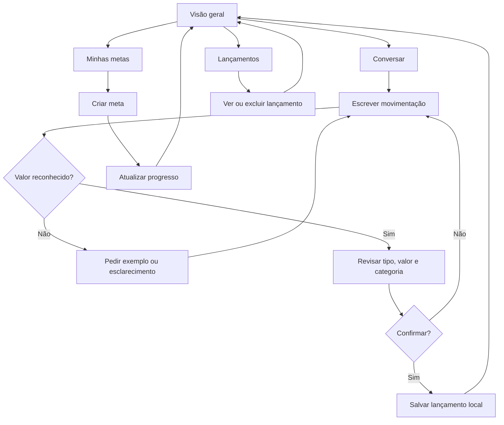

# Fluxo de telas — FinanIA

## Telas

### A. Visão geral
- Indicadores de saldo, entradas e saídas.
- Gráfico simples por categoria.
- Dicas educativas condicionadas aos lançamentos.
- Listagem das cinco últimas transações.
- Atalho para novo registro.

### B. Conversar
- Histórico de mensagens da sessão.
- Campo para informar uma movimentação.
- Resumo interpretado com campos editáveis.
- Confirmar ou cancelar.
- Resposta de ajuda para frases sem valor.
- Dicas baseadas nos lançamentos quando solicitado.

### C. Minhas metas
- Cadastro de meta com nome, valor desejado e acumulado.
- Cartão com valor acumulado, progresso e ações.
- Aportes manuais e exclusão de meta.

### D. Lançamentos
- Histórico completo de receitas e despesas.
- Exclusão de lançamento incorreto.
- Botão opcional para inserir valores fictícios de demonstração.

## Limites
Os elementos do protótipo são locais. Uma implantação no Lovable só deve ser descrita como integrada a IA, autenticação ou banco de dados depois que essas funções forem implementadas e testadas.
